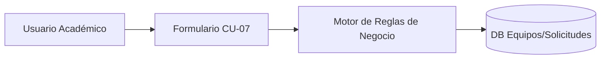

# RFC-07: Solicitud de Préstamo de Equipamiento
## Prototipo de gestión de solicitudes de préstamo

| Campo | Detalle |
| :--- | :--- |
| **Título** | RFC-07: Solicitud de Préstamo de Equipamiento |
| **Proyecto** | Prototipo Ingenieria de SW I |
| **Materia / Grupo** | Ingeniería de SW I — Grupo <N> |
| **Integrantes** | Fernandez Jeremías 
                    Gómez Abigail
        |
| **Fecha** | Noviembre 2026 |
| **Estado** | Borrador |
| **Revisores** | Docente |

---

## 1. Alcance del Prototipo y Enfoque

| Componente | Real / Simulado / Fuera de alcance | Nota |
| :--- | :--- | :--- |
| Interfaz de Usuario (CU-07) | Real | Formulario de solicitud |
| Interfaz de Catálogo (CU-04) | Real | Listado de equipos y selección |
| Validación de reglas de negocio | Real | Exclusividad de gama, plazos, stock, sanciones |
| Base de Datos de equipos y solicitudes | Real | Persistencia local |
| Autenticación de usuario | Simulado | Usuario predefinido para probar roles |
| Notificaciones externas | Fuera de alcance | Se asume funcionamiento pero no se implementa |

---

## 2. Stack Tecnológico

| Capa | Tecnología | Versión | Motivo de la elección |
| :--- | :--- | :--- | :--- |
| Frontend | HTML/JS | N/A | Simplificación |
| Backend | Python | N/A | Solicitado en el entorno |
| Persistencia | SQLite | N/A | Estándar de la materia |

---

## 3. Arquitectura

### 3.1 Alineación con el modelo de clases del proyecto

| Clase del modelo | Implementación en código | Cambios respecto del modelo |
| :--- | :--- | :--- |
| Solicitud | `models/solicitud.py` | Agregar campos de validación de gama |
| Equipo | `models/equipo.py` | Agregar atributo 'gama' |

---

## 4. Diseño Detallado

### 4.1 Flujo principal
1. Usuario visualiza el catálogo (CU-04) y selecciona equipos.
2. Al presionar "Solicitar", el sistema redirige al formulario (CU-07) con equipos y fechas precargados.
3. Usuario completa datos académicos.
4. Sistema valida: gama, años de estudio, plazos, stock y bloqueos.
5. Si es correcto, el sistema registra la solicitud y confirma.

### 4.2 Escenarios alternativos

| Extensión del CU | Condición | Comportamiento del sistema |
| :--- | :--- | :--- |
| 5a | Alumno 1er/2do año + Gama alta | Error: Solo 3er año o docentes |
| 8a | Mezcla gama media/alta | Error: No se puede mezclar |
| 8b | Plazo < 48hs (alta) / > 48hs (regular) | Error: Plazo no permitido |
| 8c | Sin stock | Error: Equipo no disponible |

---

## 8. Plan de Verificación

| ID | Criterio de aceptación | Procedimiento | Resultado esperado |
| :--- | :--- | :--- | :--- |
| TC-01 | Restricción gama alta | Alumno 1er año + gama alta | Error acceso denegado |
| TC-02 | Exclusividad de gama | Mezclar media + alta | Error combinación inválida |
| TC-03 | Validación de plazos | < 48hs (alta) | Error plazo inválido |
| TC-04 | Control de disponibilidad | Solicitar equipo sin stock | Error sin stock |

---

## 9. Riesgos y Preguntas Abiertas

| # | Riesgo / pregunta | Impacto | Mitigación |
| :--- | :--- | :--- | :--- |
| 1 | ¿Rol Docente autocompleta/bloquea? | Medio | Implementado: Se autocompleta y bloquea. |
| 2 | ¿Fechas bloqueadas en CU-07 (derivado de CU-11)? | Alto | Implementado: Se precargan y bloquean. |

---

## 10. Plan de Trabajo

| Tarea | Estimación | Estado |
| :--- | :--- | :--- |
| Implementar catálogo (CU-04) | 3hs | Pendiente |
| Definir modelos y DB | 2hs | Pendiente |
| Implementar lógica validación | 4hs | Pendiente |
| Implementar formulario CU-07 | 4hs | Pendiente |
| Integración y pruebas | 3hs | Pendiente |
