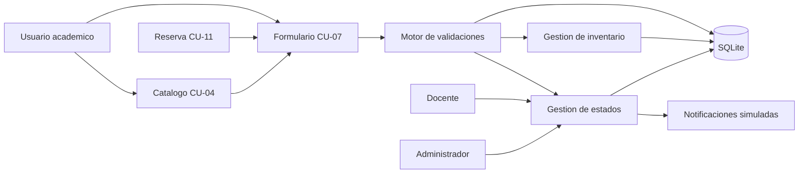

# RFC-07: Solicitud de Prestamo de Equipamiento
## Diseno aprobado del CU-07 y su integracion con CU-04, CU-06 y CU-11

| Campo | Detalle |
| :--- | :--- |
| **Titulo** | RFC-07: Solicitud de Prestamo de Equipamiento |
| **Proyecto** | Prototipo Ingenieria de SW I |
| **Materia / Grupo** | Ingenieria de SW I |
| **Integrantes** | Fernandez Jeremias, Gomez Abigail |
| **Fecha** | 24 noviembre 2026 |
| **Estado** | Aprobado — version 2.0 |
| **Revisores** | Docente y grupo |
| **Especificacion fuente** | DOCUMENTO SISTEMA.txt y spect critico prestamo.docx.txt |

---

## 1. Alcance del Prototipo

| Componente | Real / Simulado / Fuera de alcance | Nota |
| :--- | :--- | :--- |
| Catalogo de equipamiento CU-04 | Real | Busqueda, seleccion desde SQLite y derivacion al CU-07; si el inventario esta vacio se carga un conjunto de demostracion |
| Formulario de solicitud CU-07 | Real | Interfaz modernizada; datos academicos desde catalogos SQLite; equipos, cantidades y fechas |
| Estilo visual CU-04/CU-07 | Real | Paleta azul y blanca uniforme en controles y dialogos; sin cuadros nativos del sistema |
| Validaciones de negocio | Real | Gama, rol, plazo, stock, sanciones y bloqueo |
| Estados del prestamo | Real | PENDIENTE, APROBADA, ENTREGADA, DEVUELTA, FINALIZADA, RECHAZADA y CANCELADA |
| Persistencia SQLite | Real | Equipos, solicitudes, reservas y catalogos de materias/docentes relacionados |
| Gestion CU-06 | Simulado | Cambios de estado y consulta; sin integracion externa |
| Gestion CU-11 | Real en prototipo | Reserva de espacio y derivacion con fechas precargadas |
| Autenticacion | Simulado | Usuario academico, docente y administrador predefinidos |
| Notificaciones | Simulado | Registro visible y mensajes de confirmacion |
| Servicios externos, correo y mensajeria | Fuera de alcance | No se usan APIs externas |
| Hardware y dispositivos fisicos | Fuera de alcance | No se controla equipo fisico real |

### 1.1 Objetivo

Construir un prototipo escritorio que permita registrar solicitudes de prestamo,
aplicar las reglas de gama, plazo, stock y bloqueos, asignar el estado inicial,
reservar los equipos y representar el ciclo de aprobacion, entrega y devolucion.

### 1.2 Fuera del alcance de esta iteracion

- Pagina web o API HTTP.
- Base de datos compartida por multiples equipos.
- Integracion real con correo, WhatsApp o mensajeria.
- Gestion administrativa completa fuera del CU-07.
- Calculo real de sanciones basado en sistemas externos.

---

## 2. Stack Tecnologico

| Capa | Tecnologia | Version | Motivo |
| :--- | :--- | :--- | :--- |
| Frontend | Python + Tkinter | Python 3 | Interfaz de escritorio solicitada por el entorno |
| Validaciones | Python | 3.12 | Reutilizable y verificable con unittest |
| Persistencia | SQLite | Incluido con Python | Base local simple y portable |
| Pruebas | unittest | Incluido con Python | Sin dependencias externas |
| Control de versiones | Git | Disponible | Revision y trazabilidad de cambios |

### 2.1 Requisitos del entorno

- Python 3.
- Tkinter disponible en el sistema.
- Permisos de lectura y escritura sobre prestamos.db.
- Ejecucion desde la raiz del repositorio.

---

## 3. Arquitectura



### 3.1 Componentes y responsabilidades

| Componente | Responsabilidad | Depende de |
| :--- | :--- | :--- |
| Catalogo CU-04 | Buscar, filtrar y seleccionar equipos | Inventario |
| Formulario CU-07 | Recopilar datos y confirmar | Catalogo, usuario y reserva |
| Motor de validaciones | Validar gama, plazo, stock y bloqueos | Solicitud, usuario e inventario |
| Gestion de inventario | Reservar y liberar stock | SQLite |
| Gestion de estados | Cambiar estados y registrar aprobaciones | Solicitud |
| Gestion CU-11 | Crear reserva de espacio y derivar al CU-07 | Inventario y solicitudes |
| Notificaciones | Informar al solicitante y aprobadores | Gestion de estados |

### 3.2 Modelo de clases aprobado

| Clase | Implementacion prevista |
| :--- | :--- |
| UsuarioAcademico | Identidad, rol y año academico |
| Docente | Usuario que aprueba Materia Proyecto |
| Administrador | Usuario que aprueba gama alta |
| Equipo | Identificador, nombre, categoria, gama y stock |
| Solicitud | Identificador, solicitante, datos, fechas, estado y justificacion |
| PrestamoGamaAlta | Solicitud con validacion minima de 48 horas |
| PrestamoGamaMedia | Solicitud con plazo maximo de 48 horas |
| Reserva | Vinculo entre solicitud, equipo y franja horaria |
| Inventario | Consulta y reserva de disponibilidad |
| GestorPrestamo | Validaciones y transiciones de estado |
| Notificacion | Destinatario, canal, mensaje y resultado |

---

## 4. Diseno Detallado

### 4.1 Flujo principal CU-07

1. El usuario llega desde el catalogo, una solicitud nueva o una reserva CU-11.
2. El sistema muestra materia/proyecto, docente a cargo, fechas, justificacion,
   buscador, equipos y cantidades.
3. El usuario agrega equipos y completa el formulario.
4. El sistema impide agregar gama alta a un alumno de 1er o 2do año.
5. Al confirmar, valida gama unica, plazo, disponibilidad, sanciones y devoluciones vencidas.
6. Si el equipo es regular y no es Materia Proyecto, registra la solicitud como APROBADA.
7. Si es regular con Materia Proyecto, registra la solicitud como PENDIENTE y notifica al docente.
8. Si es gama alta, registra la solicitud como PENDIENTE y notifica a la Administracion.
9. El sistema registra la solicitud, asocia los equipos, reserva cantidades en la franja solicitada, devuelve un identificador y confirma la operacion.
10. Los controles y dialogos usan la paleta azul y blanca compartida, independientemente del tema visual del sistema operativo.

### 4.2 Estados y transiciones

Las maquinas de estado verificadas son:

- [PrestamoGamaAlta](/home/topsy/Escritorio/Prototipo%20Ingenieria%20de%20SW%20I/DIAGRAMAS%20DINAMICOS-PrestamoGamaAlta.jpg)
- [PrestamoGamaMedia](/home/topsy/Escritorio/Prototipo%20Ingenieria%20de%20SW%20I/DIAGRAMAS%20DINAMICOS-PrestamoGamaMediaEstadps.jpg)

| Estado | Entrada | Proximo estado | Efecto |
| :--- | :--- | :--- | :--- |
| PENDIENTE | Registro sujeto a aprobacion | APROBADA o RECHAZADA | Reserva stock; notifica al docente o la Administracion segun la gama |
| APROBADA | Aprobacion automatica, docente o administracion | ENTREGADA o CANCELADA | Conserva reserva |
| RECHAZADA | Rechazo del docente o administracion | Final terminal | Libera stock |
| ENTREGADA | Administracion registra retiro | DEVUELTA; puede permanecer ENTREGADA por extension valida | Registra entrega y permite actualizar la fecha de devolucion |
| DEVUELTA | Devolucion registrada | FINALIZADA | Libera stock |
| CANCELADA | Cancelacion antes de entrega | Final terminal | Libera stock |
| FINALIZADA | Recepcion conforme | Final terminal | Cierra prestamo |

La devolucion tardia o con faltantes puede aplicar suspension o restriccion segun
las reglas operativas registradas por la Administracion. La extension no es un
estado nuevo: desde ENTREGADA se solicita, se valida que resten al menos 24 hs
para el vencimiento y se actualiza la fecha de devolucion sin cambiar de estado.

### 4.3 Decisiones aprobadas

| Ambiguedad | Decision aprobada |
| :--- | :--- |
| Docente a cargo | Si el solicitante es docente, selecciona su identidad de la lista de docentes y el campo queda bloqueado; se muestran solo sus materias |
| Docente para su propia Materia Proyecto | La solicitud pasa directamente a APROBADA; no requiere aprobacion paralela |
| Equipos derivados de CU-11 | Las fechas se precargan y bloquean segun el horario reservado |

### 4.4 Escenarios alternativos

| Extension | Condicion | Comportamiento |
| :--- | :--- | :--- |
| 1a | Ya existe seleccion previa | Mostrar equipos, cantidades y fechas |
| 5a | Alumno 1er/2do año intenta gama alta | Rechazar seleccion |
| 7a | Usuario cancela | Descartar y volver al panel |
| 8a | Se mezclan gama alta y media | Rechazar la solicitud |
| 8b | Gama alta: menos de 48 hs | Rechazar plazo |
| 8b | Gama media/regular: mas de 48 hs | Rechazar plazo |
| 8c | Stock insuficiente | Informar equipos no disponibles |
| 8d | Sancion o devolucion vencida | Bloquear y explicar motivo y vigencia |
| CU-11 | Reserva en sabado o fuera de lunes a viernes | Rechazar segun RNF-07 |
| CU-11 | Equipo asociado | Devolucion igual al dia de retiro segun RNF-08 |

### 4.5 Interfaz y datos academicos

- Aplicar una presentacion moderna de estilo academico: paleta azul marino y fondo
  claro, secciones visualmente diferenciadas, espaciado consistente, jerarquia de
  titulos y acciones principales destacadas. Se conserva Tkinter y no se agregan
  dependencias.
- Materia/Proyecto, Docente a cargo y Justificacion son obligatorios; materia y
  docente se seleccionan desde listas desplegables de solo lectura.
- Las tablas `materia`, `docente` y `docente_materia` son la fuente de las opciones.
  La relacion permite que una materia tenga varios docentes y un docente varias
  materias. `materia.es_materia_proyecto` determina si la solicitud requiere
  aprobacion docente.
- Al elegir una materia, la lista de docentes queda restringida a quienes dictan
  esa materia; si hay un unico docente asociado, se selecciona automaticamente.
- Al elegir un docente primero, la lista de materias queda restringida a las que
  dicta. Si el solicitante es docente, se conserva la decision aprobada de
  identificar su propia identidad en la lista, bloquearla luego de seleccionarla
  y mostrar solo sus materias.
- Solicitudes regulares sin Materia Proyecto quedan APROBADAS; las de Materia
  Proyecto de alumnos quedan PENDIENTES; un docente que solicita para una materia
  que dicta queda APROBADO. Gama alta conserva el estado PENDIENTE.
- Si una lista no tiene opciones disponibles, la solicitud no se puede confirmar;
  el mensaje debe explicar que faltan datos academicos cargados en el catalogo.

Datos iniciales de demostracion: "Sonido e Iluminacion (DEMO)" (regular), "Proyecto
Audiovisual (DEMO)" (Materia Proyecto), "Docente Demo A" y "Docente Demo B". Ambas
materias estan asociadas a sus docentes mediante `docente_materia`. Solo se cargan
si no existen materias; no representan catalogo institucional real.

---

## 5. Modelo de Datos

```sql
CREATE TABLE IF NOT EXISTS equipo (
    id INTEGER PRIMARY KEY,
    nombre TEXT NOT NULL,
    categoria TEXT,
    gama TEXT NOT NULL CHECK (gama IN ('alta', 'media')),
    stock INTEGER NOT NULL CHECK (stock >= 0)
);

CREATE TABLE IF NOT EXISTS solicitud (
    id INTEGER PRIMARY KEY,
    usuario_id INTEGER NOT NULL,
    tipo TEXT NOT NULL,
    materia_proyecto TEXT,
    docente_cargo TEXT,
    materia_id INTEGER REFERENCES materia(id),
    docente_id INTEGER REFERENCES docente(id),
    justificacion TEXT,
    fecha_retiro TEXT NOT NULL,
    fecha_devolucion TEXT NOT NULL,
    estado TEXT NOT NULL,
    fecha_creacion TEXT NOT NULL
);

CREATE TABLE IF NOT EXISTS solicitud_equipo (
    solicitud_id INTEGER NOT NULL,
    equipo_id INTEGER NOT NULL,
    cantidad INTEGER NOT NULL CHECK (cantidad > 0),
    PRIMARY KEY (solicitud_id, equipo_id),
    FOREIGN KEY (solicitud_id) REFERENCES solicitud(id),
    FOREIGN KEY (equipo_id) REFERENCES equipo(id)
);

CREATE TABLE IF NOT EXISTS reserva (
    id INTEGER PRIMARY KEY,
    equipo_id INTEGER NOT NULL,
    solicitud_id INTEGER NOT NULL,
    fecha_retiro TEXT NOT NULL,
    fecha_devolucion TEXT NOT NULL,
    cantidad INTEGER NOT NULL,
    FOREIGN KEY (solicitud_id) REFERENCES solicitud(id),
    FOREIGN KEY (equipo_id) REFERENCES equipo(id)
);

CREATE TABLE IF NOT EXISTS materia (
    id INTEGER PRIMARY KEY,
    nombre TEXT NOT NULL UNIQUE,
    es_materia_proyecto INTEGER NOT NULL DEFAULT 0 CHECK (es_materia_proyecto IN (0, 1)),
    activa INTEGER NOT NULL DEFAULT 1 CHECK (activa IN (0, 1))
);

CREATE TABLE IF NOT EXISTS docente (
    id INTEGER PRIMARY KEY,
    nombre TEXT NOT NULL UNIQUE,
    activo INTEGER NOT NULL DEFAULT 1 CHECK (activo IN (0, 1))
);

CREATE TABLE IF NOT EXISTS docente_materia (
    docente_id INTEGER NOT NULL,
    materia_id INTEGER NOT NULL,
    PRIMARY KEY (docente_id, materia_id),
    FOREIGN KEY (docente_id) REFERENCES docente(id),
    FOREIGN KEY (materia_id) REFERENCES materia(id)
);
```

La inicializacion habilita las claves foraneas en su conexion. Los consumidores
deben habilitarlas en cada conexion SQLite que abran para que las restricciones
se apliquen. Las relaciones no permiten referencias a solicitudes o equipos
inexistentes. Al actualizar una base existente, se conservan las solicitudes y se
agregan `materia_id` y `docente_id` como referencias opcionales para filas historicas;
las nuevas solicitudes deben tener ambas referencias.

Las tablas adicionales pueden incorporar usuarios, sanciones, reservas de espacios,
historial de estados y notificaciones durante el ciclo de implementacion.

El catalogo carga automaticamente tres equipos de demostracion solo cuando la tabla
`equipo` esta vacia. Estos datos conservan los ejemplos que antes estaban codificados
en CU-04; no representan inventario real. Las materias y docentes de demostracion se
cargan solo si ambas tablas estan vacias; en otro caso se usa el contenido existente
y no se mezclan registros ficticios con los reales.

---

## 6. Interfaces

### 6.1 Contratos internos

| Operacion | Entrada | Resultado |
| :--- | :--- | :--- |
| validar_gama | Lista de equipos | True o mezcla rechazada |
| validar_restriccion_alta | Año y rol | True o acceso denegado |
| validar_plazos | Fechas y gama | True o plazo invalido |
| validar_disponibilidad | Equipos, cantidades y franja | Lista disponible o faltantes |
| validar_bloqueos | Usuario | True o motivo de bloqueo |
| registrar_solicitud | Datos y equipos | Identificador y estado inicial |

### 6.2 Comunicacion entre pantallas

El catalogo entrega uno o mas equipos al formulario CU-07.
CU-11 entrega la reserva y precarga el horario asociado.
CU-07 entrega el identificador al panel de historial CU-06.
La integracion de CU-04 transmite los identificadores seleccionados y permite
completar cantidades, datos del solicitante y fechas antes de confirmar.

---

## 7. Estructura del Codigo

```text
gui_cu07.py
catalogo_cu04.py
persistencia.py
ui_theme.py
formulario_cu07.py
validaciones.py
init_db.py
test_validaciones_cu07.py
test_init_db.py
test_persistencia.py
prestamos.db
RFC_CU07.md
README.md
```

### 7.1 Ejecucion

```bash
python3 init_db.py
python3 catalogo_cu04.py
python3 formulario_cu07.py
python3 -m unittest -v test_init_db.py test_persistencia.py test_validaciones_cu07.py
```

---

## 8. Plan de Verificacion

| ID | Requisito | Criterio de aceptacion | Procedimiento | Resultado esperado |
| :--- | :--- | :--- | :--- | :--- |
| TC-01 | RNF-05 | Alumno 1er/2do año no agrega gama alta | Solicitar equipo alta con año 1 o 2 | Acceso denegado |
| TC-02 | CU-07 Ext. 8a | No mezclar gamas | Combinar alta y media | Solicitud rechazada |
| TC-03 | RNF-04/RNF-26 | Plazo minimo/maximo por gama | Probar alta con 24/48 hs y media con 48/72 hs | Alta rechaza <48; media rechaza >48 |
| TC-04 | RNF-22 | Stock insuficiente | Solicitar mas unidades que las disponibles en una franja ocupada | Se rechaza la operacion sin guardar solicitud parcial |
| TC-05 | Fechas | Campo vacio, formato no canonico o fecha inexistente | Ingresar fechas vacias, `2026-2-3` o una fecha imposible | Mensaje de fecha invalida y ninguna solicitud persistida |
| TC-06 | Fechas | Retiro pasado, devolucion anterior o igual | Ejecutar casos borde | Operacion rechazada |
| TC-07 | Postcondiciones | Gama media normal | Confirmar solicitud valida sin Proyecto | Estado APROBADA |
| TC-08 | Materia Proyecto | Gama media con docente | Confirmar solicitud valida | PENDIENTE y notificacion docente |
| TC-09 | Gama alta | Alumno 3er año o docente | Confirmar solicitud valida | PENDIENTE y notificacion administracion |
| TC-10 | RNF-24 | Usuario sancionado | Confirmar con sancion activa | Bloqueo con motivo y vigencia |
| TC-11 | RNF-07/RNF-08 | Reserva derivada | Reservar fuera de horario permitido o de varios dias | Rechazo o fecha bloqueada |
| TC-12 | Integracion CU-04 | Seleccion del catalogo | Seleccionar uno o mas equipos y presionar Solicitar | El CU-07 muestra los equipos seleccionados y permite completar cantidades y datos |
| TC-13 | Integracion CU-11 | Reserva con equipamiento | Elegir equipo complementario | Fechas precargadas y bloqueadas |
| TC-14 | Estados | Aprobacion, entrega y devolucion | Ejecutar las transiciones | Estados correctos y stock liberado |
| TC-15 | Estados/extension | Solicitar extension durante ENTREGADA | Solicitar con 24 hs o mas restantes y con menos de 24 hs | Con margen suficiente actualiza fecha; en otro caso rechaza sin cambiar ENTREGADA |
| TC-16 | Estados/cancelacion | Cancelar una solicitud APROBADA | Cancelar antes de registrar la entrega | Estado CANCELADA y stock liberado |
| TC-17 | Persistencia | Inicializar el esquema SQLite | Ejecutar `init_db.py` sobre una base vacia y nuevamente sobre la misma base; intentar insertar relaciones invalidas | Existen las cuatro tablas, la segunda ejecucion conserva datos y las referencias inexistentes se rechazan |
| TC-18 | CU-07/datos requeridos | Completar solicitud | Dejar vacia Materia/Proyecto, Docente a cargo o Justificacion e intentar confirmar | El formulario identifica el campo y no crea filas en solicitud ni reserva |
| TC-19 | CU-07/catalogos academicos | Filtrar listas desplegables | Elegir materia, luego docente; repetir eligiendo primero docente | Solo se ofrecen pares asociados en `docente_materia`; una unica opcion queda precargada |
| TC-20 | Interfaz CU-07 | Recorrer formulario modernizado | Abrir CU-04, seleccionar equipos y continuar al formulario en Tkinter | Secciones de datos, equipos y fechas son visibles y la seleccion inicial se conserva; sin dependencias externas |
| TC-21 | Estado inicial | Solicitudes por tipo de materia | Registrar materia regular, materia proyecto de alumno, materia proyecto de docente y gama alta | Estados APROBADA, PENDIENTE, APROBADA y PENDIENTE respectivamente |
| TC-22 | Interfaz CU-04/CU-07 | Uniformidad visual | Abrir ambas pantallas y mostrar avisos de error, advertencia y confirmacion | Botones, campos y contenido de dialogos conservan la paleta azul y blanca sin controles beige del tema del sistema |

---

## 9. Requisitos no funcionales

| RNF | Criterio medible |
| :--- | :--- |
| RNF-07 | La reserva solo admite lunes a viernes |
| RNF-08 | Equipamiento derivado de CU-11 devuelve el mismo dia |
| RNF-22 | Toda confirmacion valida stock antes de persistir |
| RNF-24 | Toda confirmacion verifica sanciones y prestamos vencidos |
| RNF-04 | Gama alta acepta duracion >=48 horas |
| RNF-26 | Gama media acepta duracion <=48 horas |
| Rendimiento | Validacion local completa en menos de 1 segundo |
| Disponibilidad | Un inventario no puede quedar reservado dos veces en la misma franja |

---

## 10. Riesgos

| Riesgo | Impacto | Mitigacion |
| :--- | :--- | :--- |
| Stock persistido sin concurrencia | Alto | Validar y reservar dentro de una transaccion SQLite |
| Fechas inconsistentes con hora | Medio | Mantener formato YYYY-MM-DD para el prototipo y documentar limite |
| Estado fuera de las transiciones | Alto | Centralizar cambios en un unico GestorPrestamo |
| Simulacion confundida con integracion real | Medio | Mostrar claramente usuario y notificacion simulados |
| Codigo sin correspondencia con el RFC | Alto | Ejecutar TC y actualizar el RFC ante desvíos |

---

## 11. Plan de Trabajo

| Tarea | Requisito | Estado |
| :--- | :--- | :--- |
| Mejorar modelo SQLite | Modelos y persistencia/TC-17 | Completada |
| Integrar seleccion real CU-04 a CU-07 | RF-04/CU-07/TC-12 | Completada |
| Completar stock por cantidad y franja | RNF-22/TC-04 | Completada |
| Modernizar interfaz CU-04/CU-07 | CU-07/TC-20 | Completada |
| Crear catalogos de materias y docentes | CU-07/TC-18/TC-19/TC-21 | Completada |
| Completar bloqueo por sanciones | RNF-24/RNF-25 | Pendiente |
| Implementar estados y transiciones | RF-12/RF-13 | Pendiente |
| Implementar notificaciones simuladas | RF-18/RF-33 | Pendiente |
| Implementar derivacion CU-11 | RNF-07/RNF-08 | Pendiente |
| Completar TC-01 a TC-14 | Plan de verificacion | Pendiente |

---

## 12. Historial de Cambios

| Version | Fecha | Autor | Cambio |
| :--- | :--- | :--- | :--- |
| 0.1 | Noviembre 2026 | Grupo | RFC inicial incompleto |
| 1.0 | 24 noviembre 2026 | Grupo | RFC aprobado basado en CU y diagramas corregidos |
| 1.1 | 24 noviembre 2026 | Grupo | RFC alineado con los diagramas de maquina de estado de PrestamoGamaAlta y PrestamoGamaMedia; la extension queda documentada como transicion interna de ENTREGADA |
| 1.2 | 24 noviembre 2026 | Grupo | Se especifican claves foraneas del modelo SQLite y TC-17 para comprobar inicializacion e integridad referencial |
| 1.3 | 24 noviembre 2026 | Grupo | Se implementa y valida TC-17; se recrea prestamos.db con las cuatro tablas del modelo |
| 1.4 | 24 noviembre 2026 | Grupo | Se integra el catalogo CU-04 con la interfaz CU-07, se registran solicitudes y reservas en SQLite, y se documentan los datos de demostracion del catalogo |
| 1.5 | 24 noviembre 2026 | Grupo | Se registra la propuesta de interfaz modernizada, campos academicos obligatorios y listas de materia/docente relacionadas |
| 1.6 | 24 noviembre 2026 | Grupo | Se refuerza la validacion del formato exacto de fechas y se comprueba que la persistencia rechace fechas vacias, invalidas o pasadas |
| 1.7 | 24 noviembre 2026 | Grupo | Se aprueba la interfaz modernizada, los campos academicos obligatorios, los catalogos relacionales y los datos de demostracion |
| 1.8 | 24 noviembre 2026 | Grupo | Se define el indicador es_materia_proyecto como fuente de verdad para determinar la aprobacion de solicitudes regulares |
| 1.9 | 24 noviembre 2026 | Grupo | Se implementan TC-18 a TC-21: campos obligatorios, catalogos academicos relacionados, datos de demostracion, estados por tipo de materia e interfaz modernizada |
| 2.0 | 24 noviembre 2026 | Grupo | Se unifican los botones y dialogos de CU-04/CU-07 con la paleta azul y blanca y se agrega TC-22 |

---

## Checklist de Aprobacion

- [x] RF/RNF cubiertos por casos de prueba.
- [x] RNF expresados con criterios medibles.
- [x] Alcance real, simulado y fuera de alcance definido.
- [x] Stack y versiones definidos.
- [x] Ambiguedades resueltas por decisiones registradas.
- [x] Comandos y pruebas de la implementacion ejecutados en la fase de build.
- [x] Implementacion sincronizada con este RFC; los casos aun pendientes estan listados en el plan de trabajo.
